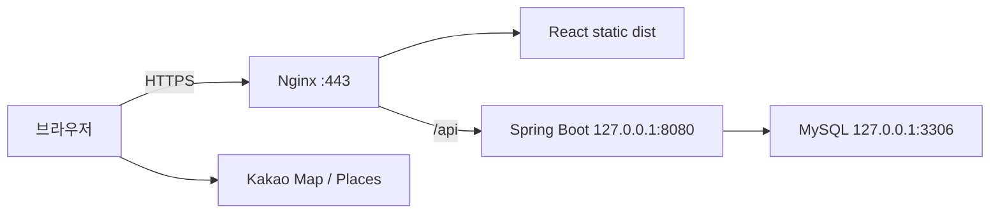

# ParkEasy 포트폴리오 공개 배포 계획

기준: 2026-09-28. **Lightsail 서울 단일 Linux VM + 같은 VM의 MySQL**을 기본안으로 확정한다. 별도 staging VM, managed DB, load balancer, Kubernetes는 초기 구성에 넣지 않는다. 기존 staging 문서는 smoke/rollback 참고자료로 재사용한다.

이번 작업은 문서·템플릿 준비만 수행했다. 서버 생성/결제/SSH/공개 배포/DB dump/restore/migration/sync는 실행하지 않았다. 이후 실제 작업도 각 변경 전 사용자 승인을 받는다.

## 1. 배포처와 월 비용

무료 체험·크레딧을 제외한 비용으로 비교한다. 세금/환율/도메인/백업/트래픽 초과분은 별도다. 아래 가격은 확인일 기준이며 결제 직전에 콘솔 견적을 재확인한다.

| 후보 | 비용 | 난이도·판단 |
|---|---|---|
| AWS EC2 | 인스턴스+EBS+IPv4+트래픽 합산. 4GB급 총 월 $40~60을 초기 예산으로 가정하되 서울 견적 미확정 | 유연하지만 비용 항목·설정이 많음. 이번 기본안에서 제외 |
| Oracle Cloud A1 | Always Free 한도 내 VM $0. 현재 공식 문서는 2 OCPU/12GB 상당과 block volume 총 200GB 안내 | ARM 호환 확인, home region 용량 부족·유휴 회수 조건. 무료 최우선일 때 대안 |
| 국내 VPS: 카페24 Linux 자이언트 | 월 33,000원(VAT 포함), 4GB/100GB, 설치비 별도 확인 | 원화 결제·국내 지원. CPU 할당·지원 OS/MySQL 버전 확인 필요 |
| **기타 저비용 VM: AWS Lightsail** | **월 $24**, public IPv4 포함 Linux 2 vCPU/4GB/80GB | 번들 가격과 단일 VM 운영이 단순. **추천** |

근거: [EC2 요금](https://aws.amazon.com/ec2/pricing/on-demand/)과 [IPv4 요금](https://aws.amazon.com/vpc/pricing/)은 별도 항목이다(IPv4 $0.005/시간, 월 730시간이면 $3.65). EC2 총액은 견적이 아닌 예산 추정이다. [Oracle 현재 무료 조건](https://docs.oracle.com/en-us/iaas/Content/FreeTier/freetier_topic-Always_Free_Resources.htm), [카페24 Linux VPS](https://hosting.cafe24.com/?controller=new_product_page&page=virtual), [Lightsail 공식 가격](https://aws.amazon.com/lightsail/pricing/)을 비교했다. 과거 Oracle 4 OCPU/24GB 설명을 현재 보장 조건으로 사용하지 않는다.

추천안 총 예산: **월 $27~32 + 적용 세금** 정도를 확보한다. $24 VM에 외부 백업 $1~5, 도메인 연 비용의 월 환산 $1~3을 더한 추정이며 도메인/백업 상품 견적은 아직 없다. 기존 도메인을 쓰고 백업을 로컬에 보관하면 $24에 가까워질 수 있다. 환율은 고정 가정하지 않는다. 초과 전송량과 미사용 자원 비용은 콘솔에서 확인하고 예산 알림을 건다.

## 2. 사양·DB 구성

권장 시작 사양은 **2 vCPU, RAM 4GB, SSD 80GB, Ubuntu 24.04 LTS, Java 17**이다. 26.7만 lot + 26.7만 operation만으로 RAM 용량을 단정할 수는 없으나, 저트래픽 조회용 서비스의 시작점으로 적절하다고 판단한다. 성능 보장이 아닌 초기 용량 계획이다. 1GB는 제외하고, 2GB는 Java/MySQL 동시 구동의 여유가 작아 기본안으로 삼지 않는다.

- Java heap 최대 1GB, MySQL buffer pool 시작값 1GB 정도, OS/nginx/native memory용 나머지 여유. 실제 RSS·swap·쿼리 지연을 관찰해 조정한다.
- 작은 VM에서 frontend/backend build를 수행하지 않는다. 로컬/CI에서 검증한 JAR/dist만 전송한다.
- 데이터+index 실제 크기를 SELECT로 먼저 확인한다. OS·release·복구용 덤프·로그를 포함해 disk 20~30% 여유를 유지한다. row 수만으로 dump 크기를 추정하지 않는다.
- Java/MySQL RSS, disk, health, 오류율을 확인한다. OOM·지속 swap·smoke 지연이 나타나면 RAM 8GB 또는 쿼리 튜닝을 검토한다.

| DB 방식 | 비용/운영 | 결정 |
|---|---|---|
| 같은 VM MySQL | 별도 DB 인스턴스 비용 없음. 백업/패치 담당 필요, VM 장애 시 앱과 DB 함께 중단 | **초기 채택** |
| managed MySQL | 별도 고정 비용, 네트워크/접속 설정 추가. 자동 백업 등 운영 편의 | 사용량/가용성 필요가 생기면 재검토 |

MySQL은 `127.0.0.1`에만 listen, 3306 외부 공개 금지. backend도 localhost:8080만 사용한다. 외부는 80/443, SSH는 작업자 IP만 허용한다. 앱 계정은 업무 테이블 SELECT만 부여한다. 복구 계정은 별도이며 web ENV에 넣지 않는다. 운영 데이터는 읽기 중심의 snapshot으로 제공하고 scheduler/admin은 계속 OFF다.



## 3. 디렉터리와 실행 설정

```text
/srv/parkeasy/backend/releases/<release-id>/backend.jar
/srv/parkeasy/backend/current -> releases/<release-id>
/srv/parkeasy/frontend/releases/<release-id>/index.html (+ assets/)
/srv/parkeasy/frontend/current -> releases/<release-id>
/etc/parkeasy/parkeasy.env                 # root:root 0600
/etc/systemd/system/parkeasy-backend.service
/etc/nginx/conf.d/parkeasy.conf
/var/www/letsencrypt/.well-known/acme-challenge/
/etc/letsencrypt/live/<domain>/
/var/backups/parkeasy/                    # web root 밖, 접근 제한
```

dist 디렉터리의 **내용**을 frontend release로 복사한다. 소스/.env/dump/log를 web root에 포함하지 않는다. release 디렉터리는 배포자 소유, 앱 계정은 읽기만 허용한다. nginx도 정적 파일을 읽을 권한만 갖는다. 이전 release를 한 개 이상 보존한다.

준비된 템플릿:

- [parkeasy-backend.service](public-deploy/parkeasy-backend.service.example): 전용 non-root `parkeasy`, EnvironmentFile, Java heap 한도, prod 단일 profile, Flyway/DDL/init/admin/scheduler OFF, `Restart=on-failure` 및 재시작 횟수 제한, journal.
- [HTTP 발급용 설정](public-deploy/nginx-bootstrap.conf.example): 인증서 발급 전 challenge만 제공하며 서비스 요청은 503.
- [최종 HTTPS 설정](public-deploy/nginx-https.conf.example): static/SPA, `/api` 보존 reverse proxy, forwarded headers, timeout, admin/legacy exact block, health proxy 허용.

nginx는 `$uri` 기반 access log를 사용한다. query/header/body를 기록하지 않는다. 초기 설정의 error log는 request/query 노출 방지를 위해 비활성화되어 있어 진단 정보가 제한된다. access status/latency와 보호된 앱 journal로 관찰하고, 오류 로그가 필요하면 먼저 마스킹 방식을 결정한다. 앱 로그도 secret scanner로 검증하며 원문을 공유하지 않는다.

### ENV 이름만

| 용도 | 이름 |
|---|---|
| DB URL | `PARKEASY_DB_URL` |
| DB username | `PARKEASY_DB_USERNAME` |
| DB password | `PARKEASY_DB_PASSWORD` |
| 공공 데이터 service key | `PARKEASY_PUBLIC_DATA_SERVICE_KEY` |
| CORS origin | `PARKEASY_CORS_ALLOWED_ORIGINS` |
| Kakao JS key, frontend build 시점 | `VITE_KAKAO_MAP_KEY` |
| active profile | `SPRING_PROFILES_ACTIVE` |

profile은 `prod` 단일 사용. 같은 origin의 frontend/API는 CORS가 없어도 동작한다. 외부 origin이 필요할 때만 정확한 origin을 허용하고 wildcard를 사용하지 않는다. service key는 수집 OFF인 웹 서비스에 주입하지 않아도 된다. DB password/service key는 VITE 변수로 넣지 않는다. Kakao JS key는 브라우저용이므로 공개 domain을 Kakao 콘솔에 등록하고 해당 build의 dist를 사용한다. 실제 값은 문서/CLI/로그에 쓰지 않는다.

## 4. 도메인·Let's Encrypt

단일 hostname 하나를 쓴다(예: 보유 domain의 `parking` subdomain). DNS의 A record를 VM에 연결한 고정 public IPv4로 지정한다. IPv6를 실제로 설정하지 않았다면 AAAA를 추가하지 않는다. DNS 전파 후 외부에서 해당 VM을 가리키는지 확인하고 80/443을 연다. 별도 CDN은 필수가 아니다.

인증서가 없는 상태에서 HTTPS 설정을 먼저 활성화하면 nginx가 시작하지 못한다. 순서:

1. 실제 domain으로 치환한 bootstrap HTTP 설정만 설치. `nginx -t` 후 승인된 reload.
2. `/var/www/letsencrypt`를 준비하고 Certbot 설치. 아래 webroot 방식으로 발급한다.
3. 인증서 생성 성공 후 최종 HTTPS 템플릿을 설치하고 domain·인증서 경로를 일치시킨다. `nginx -t` 후 승인된 reload.
4. Certbot 자동 갱신 timer와 nginx reload deploy hook을 확인하고 `renew --dry-run` 성공을 확인한다. 초기 TLS 발급/갱신 역시 이번에는 실행하지 않는다.

```bash
# 향후 승인 후만 실행. DOMAIN/ACME_EMAIL은 운영자가 지정한다.
sudo certbot certonly --webroot -w /var/www/letsencrypt \
  --cert-name "$DOMAIN" -d "$DOMAIN" --email "$ACME_EMAIL" --agree-tos
sudo certbot renew --dry-run
```

갱신 후 hook 예시(`/etc/letsencrypt/renewal-hooks/deploy/reload-nginx`, root 소유 실행 파일):

```sh
#!/bin/sh
/usr/sbin/nginx -t && /usr/bin/systemctl reload nginx
```

HTTP challenge 경로는 HTTPS 전환 후에도 80에서 허용한다. 실제 바이너리 경로·timer 이름은 설치 방식에 맞게 확인한다. TLS 인증서 비용은 무료이며 domain 등록비는 별도다. [Let's Encrypt HTTP-01](https://letsencrypt.org/docs/challenge-types/) 및 [Certbot webroot/renew 문서](https://eff-certbot.readthedocs.io/en/stable/using.html)를 따른다.

## 5. 로컬 데이터 이전 — dump/restore 우선

**실제 dump/DB 접속은 이번 단계에서 하지 않았다.** 다음은 이후 별도 승인할 이전 작업이다. 공공 API 전국 재수집은 필요하지 않다.

### 무엇을 옮기는가

V13에 존재하는 앱 테이블 5개와 Flyway history의 **구조**를 모두 옮긴다. 데이터는 조회용 3개와 history만 옮기는 것이 기본안이다.

| 테이블 | 구조 | 데이터 |
|---|---|---|
| parking_lot | 보존 | 이전 |
| parking_operation | 보존 | 이전 |
| parking_realtime | 보존 | 이전, 원래 received_at/observed_at 유지 |
| parking_sync_job | 보존 | 제외: 작업 이력/오류 문자열 노출과 재개 혼동 방지 |
| parking_sync_skipped_page | 보존 | 제외: sync job 데이터와 함께 제외 |
| flyway_schema_history | 보존 | 검증된 V1~V13 이력·checksum 그대로 이전 |

`mysql/sys/performance_schema/information_schema` 및 사용자/권한 테이블, routines/events/triggers는 덤프 대상에서 제외한다. 실제 앱에 trigger/routine 등 추가 객체가 있으면 자동으로 누락시키지 말고 검토 후 STOP/수정한다. V1~V13 외 객체·version/checksum 불일치 역시 STOP이다. worker 테이블은 빈 테이블로 남기므로 V13 schema를 허위로 주장하지 않는다. checkpoint 데이터는 로컬에 남으며 공개 서버가 수집을 이어받지 않는다.

### 이전 전 확인

- 로컬과 대상 `SELECT VERSION()`, charset/collation/sql_mode/time_zone, 테이블 engine 및 V1~V13 성공/checksum 확인. 현재 SQL의 `utf8mb4_0900_ai_ci` 때문에 MariaDB로 바꿔 넣지 않는다. 원본 MySQL 버전은 아직 미확인이다.
- 기본은 원본과 호환되는 MySQL 8.x. Ubuntu 패키지의 버전과 원본이 다르면 빈 복구 DB에서 먼저 검증하고 downgrade를 강행하지 않는다.
- 원본의 scheduler·수동 sync·DDL을 멈춘 상태로 snapshot 시각을 기록한다. 아래 두 덤프 사이에도 원본 schema와 데이터가 바뀌지 않게 한다.
- 데이터/index 실제 크기, 세 테이블의 정확한 COUNT, ID 범위, operation/realtime orphan count, 시간 필드 범위, 서울역 조회 샘플을 SELECT로 기록한다. 기존 값을 임의 갱신하지 않는다.
- 기존 로컬 backup을 보존하고 dump 생성 후 암호화된 다른 위치에도 사본을 둔다. SHA-256과 생성 완료 exit code를 기록한다.

```sql
SELECT VERSION();
SELECT table_name, engine, data_length, index_length
FROM information_schema.tables WHERE table_schema = DATABASE();
SELECT installed_rank, version, description, checksum, success
FROM flyway_schema_history ORDER BY installed_rank;
SELECT COUNT(*) FROM parking_lot;
SELECT COUNT(*) FROM parking_operation;
SELECT COUNT(*) FROM parking_realtime;
SELECT COUNT(*) AS operation_orphans FROM parking_operation o
LEFT JOIN parking_lot p ON p.id=o.parking_lot_id WHERE p.id IS NULL;
SELECT COUNT(*) AS realtime_orphans FROM parking_realtime r
LEFT JOIN parking_lot p ON p.id=r.parking_lot_id WHERE p.id IS NULL;
```

### 승인 후 사용할 dump 명령 예시 — 지금 실행 금지

Linux/Bash 또는 WSL의 MySQL client 예시다. Windows PowerShell 출력 redirection으로 dump 인코딩을 바꾸지 않도록 `--result-file`을 사용한다. `.cnf`는 보호된 MySQL client 설정이며 password를 인자에 쓰지 않는다. DB 이름/파일 경로 변수는 미리 지정하고 검증한다.

```bash
set +x
set -euo pipefail
umask 077
: "${SOURCE_DB:?}" "${PRIVATE_DIR:?}"
# 기존 파일을 덮어쓰지 않는 새 보호 디렉터리를 사용한다.
test ! -e "$PRIVATE_DIR/schema.sql"
test ! -e "$PRIVATE_DIR/data.sql"
mysqldump --defaults-extra-file=/run/secrets/parkeasy-source.cnf \
  --single-transaction --quick --no-tablespaces --set-gtid-purged=OFF \
  --skip-triggers --routines=false --events=false --no-data --skip-add-drop-table \
  --result-file="$PRIVATE_DIR/schema.sql" \
  "$SOURCE_DB" parking_lot parking_operation parking_realtime \
  parking_sync_job parking_sync_skipped_page flyway_schema_history \
  2> "$PRIVATE_DIR/schema.err"
mysqldump --defaults-extra-file=/run/secrets/parkeasy-source.cnf \
  --single-transaction --quick --no-tablespaces --set-gtid-purged=OFF \
  --skip-triggers --routines=false --events=false --no-create-info \
  --skip-add-locks --hex-blob --result-file="$PRIVATE_DIR/data.sql" \
  "$SOURCE_DB" parking_lot parking_operation parking_realtime flyway_schema_history \
  2> "$PRIVATE_DIR/data.err"
test -s "$PRIVATE_DIR/schema.sql"
test -s "$PRIVATE_DIR/data.sql"
(cd "$PRIVATE_DIR" && sha256sum schema.sql data.sql > SHA256SUMS)
```

`--single-transaction`은 InnoDB의 일관된 snapshot을 위한 옵션이며 동시 DDL을 허용하지 않는다. 위 옵션은 [MySQL mysqldump 공식 문서](https://dev.mysql.com/doc/refman/8.0/en/mysqldump.html)를 기준으로 했다. 덤프는 password를 포함하지 않더라도 데이터 파일이므로 비공개로 전송/보관한다. dump 내용과 오류 원문을 채팅/로그에 출력하지 않는다.

### 복원·Flyway 처리

별도 승인 후 VM 안에 **새 빈 앱 DB**와 임시 복구 계정을 만든다. 기존 DB를 덮지 않는다. charset/collation을 원본과 맞추고 dump를 SSH로 전송해 SHA-256을 확인한다. 서비스는 아직 기동하지 않는다.

```bash
# 미래의 승인된 복구 작업만. TARGET_DB는 새 빈 DB임을 먼저 확인한다.
mysql --defaults-extra-file=/run/secrets/parkeasy-restore.cnf \
  "$TARGET_DB" < "$PRIVATE_DIR/schema.sql" 2> "$PRIVATE_DIR/restore-schema.err"
mysql --defaults-extra-file=/run/secrets/parkeasy-restore.cnf \
  "$TARGET_DB" < "$PRIVATE_DIR/data.sql" 2> "$PRIVATE_DIR/restore-data.err"
```

각 명령 exit 0 필수. 실패 시 앱 기동을 중단하고 부분 복원 DB를 정상으로 간주하지 않는다. 임의 repair나 덤프 재실행으로 덮지 않고 새 복구 대상을 준비한다. FK 체크가 dump 내에서 일시 해제될 수 있으므로 복원 후 orphan SELECT를 반드시 다시 확인한다.

복원 후 구조/index/FK, 세 테이블 row count/ID/샘플, 원본 timestamp, V1~V13 success/checksum을 비교한다. 후보 JAR의 migration SQL로 Flyway `info`/`validate`만 수행한다(callback 없는 설정·읽기 전용 계정). `migrate`, V2 seed 재실행, history 수동 편집/baseline/repair는 금지한다. 이 검증이 끝나야 앱의 read-only 계정과 연결한다.

restore는 그 자체로 DDL/INSERT 작업이므로 이후 데이터 이전 승인에 명시적으로 포함해야 한다. 이번 단계의 문서 준비 승인으로 실행하지 않는다. dump/restore 검증 후 임시 복구 credential·서버 임시 dump는 노출되지 않게 보관/정리하고 별도 백업 사본을 유지한다.

## 6. 실제 배포 순서 A~I

| 단계 | 작업 | 통과 조건 |
|---|---|---|
| A VM | 사용자 승인 후 서울 VM·고정 IP·방화벽·domain DNS 준비 | 대상/비용/접속 승인 |
| B 설치 | Java 17, 원본 호환 MySQL, nginx, Certbot 설치; 앱 OS 계정/경로 준비 | 버전·disk/RAM·포트 확인 |
| C DB | 새 빈 DB 생성, 승인된 dump/restore, read-only 앱 계정 준비 | backup·row/schema/FK·V13/checksum 검증 |
| D backend | secret ENV, 검증 JAR, systemd 배치·기동 | loopback live/ready 모두 200 |
| E frontend | domain 등록된 Kakao key로 build한 dist 전송, hash 확인·전환 | index/assets 일치 |
| F nginx | bootstrap HTTP와 ACME 경로 설정 | nginx -t 성공, challenge 외 503 |
| G TLS | 발급→HTTPS 설정→승인 reload, 갱신 검증 | 인증서/redirect/갱신 정상 |
| H health | 외부 HTTPS live/ready | 둘 다 200/UP |
| I smoke | API/UI/security 및 로그 검사 | 아래 필수 항목 PASS |

기동은 `sudo systemctl start parkeasy-backend`(기존 기동 상태면 별도 restart 승인), nginx 변경은 `sudo nginx -t` 성공 후 승인된 reload로 수행한다. 재부팅 후 기동을 위해 enable 여부도 실제 배포 때 확인한다. C/D/G 실패 시 뒤 단계로 진행하지 않는다. 최초 인증서 발급 전 공개 요청은 503이고 완전한 smoke 통과 전에는 작업자만 접근하도록 임시 제한한다.

## 7. 공개 smoke·rollback

- [ ] HTTPS 인증서 정상, HTTP→HTTPS, SPA 새로고침, 정적 asset 정상
- [ ] `/api/health/live`, `/api/health/ready` = 200/UP
- [ ] 서울역 37.5547/126.9706, radius=2000, limit=100: nearby 정상, 최대 100개
- [ ] DISTANCE/FEE/AVAILABLE 순서·null/stale 우선순위, detail/목록 요금 일치
- [ ] 지도/Places/cluster, 서울역 검색, desktop와 폭 390px mobile
- [ ] 잔여 0면은 만차 확정으로 표현하지 않음; stale·정보 없음 구분; unsupported filter 안내
- [ ] `/api/admin`와 하위 경로 404; `/api/parking-lots`와 trailing slash/query도 edge 404; nearby/detail은 허용
- [ ] same-origin UI 정상, 비허용 CORS origin 불허. 허용 cross-origin을 설정했다면 별도 origin에서 GET/OPTIONS 200과 정확한 ACAO 검증
- [ ] 입력 오류에서 stacktrace/SQL/secret 비노출, 시작~smoke 로그 검사 완료
- [ ] 8080/3306 외부 접근 불가, SSH 제한, scheduler/admin/Flyway OFF

curl과 JSON 정렬 검사 함수는 [기존 체크리스트 §6~9](staging-go-live-checklist.md)를 재사용하되 BASE를 공개 domain으로 변경한다. CORS를 설정하지 않은 단일 origin 운영에서는 허용 cross-origin 테스트를 적용 대상으로 삼지 않는다. 테스트 목적으로 임의 origin을 영구 허용하지 않는다.

realtime timestamp는 dump 시점 그대로 보존한다. 공개 후 시간이 지나면 stale일 수 있으며 UI에 그대로 표시한다. scheduler OFF이므로 자동 갱신되는 서비스라고 설명하지 않는다. 현재 시각으로 timestamp를 덮거나 fresh로 위장하지 않는다.

FAIL 시 다음 단계 중단. 직전 JAR/dist release와 nginx config로 되돌리고 health/smoke 재확인한다. DB를 바꾸지 않은 앱 배포 실패 때문에 DB를 restore하지 않는다. 초기 restore 실패 시 공개하지 않고 보존된 원본/백업에서 새 빈 DB로 재검증한다. 이전 release가 없는 최초 배포의 rollback은 서비스 공개 철회다. 정기 운영은 데이터가 바뀔 때와 배포 전에 외부 백업을 남기고 월 1회 복구 가능 여부를 확인하는 수준으로 시작한다.

## 8. README/포트폴리오 작성 항목

공개 완료 후 README 첫 화면에 실제 URL, desktop/mobile 화면, 마지막 데이터 snapshot 시각, stale 한계를 표시한다. 배포 전에는 live URL을 만들어 쓰거나 배포 완료라고 주장하지 않는다.

| 주제 | 설명·증거 |
|---|---|
| 아키텍처 | React/Kakao → nginx → Spring Boot → MySQL 단일 VM 그림 |
| 데이터 수집 | facility/operation/realtime 분리, 외부 ID와 매칭, 사용자 제공 약 26.7만건은 실제 COUNT 날짜와 함께 갱신 |
| checkpoint/retry | next page/last success, 실패 분류/backoff/재시작/empty page 정책과 관련 테스트 |
| N+1 개선 | 실제 service/repository 코드, 개선 전후 SQL 수와 검증 방법; 측정값 없으면 숫자를 만들지 않음 |
| nearby 성능 | 공간 범위 축소·거리 계산·limit/정렬, DB 크기/인덱스/환경/동시성/p50/p95와 측정 날짜 |
| realtime 판단 | provider coverage, stale/unknown/0 구분, 수집 비용과 초기 OFF 결정 |
| 배포 | Lightsail 사양·월 비용, systemd/nginx/TLS, read-only DB, dump/restore와 rollback |
| 한계와 다음 단계 | snapshot 조회 서비스, 단일 VM 장애 시 중단, 실제 수요 발생 후 scheduler/DB 분리 검토 |

기존 README의 오래된 DB 미구성 설명을 현재 profile/ENV 안내로 수정하고 본 계획을 연결했다. 나머지 실측 성능·공개 URL·스크린샷은 실제 배포 후 채운다.
